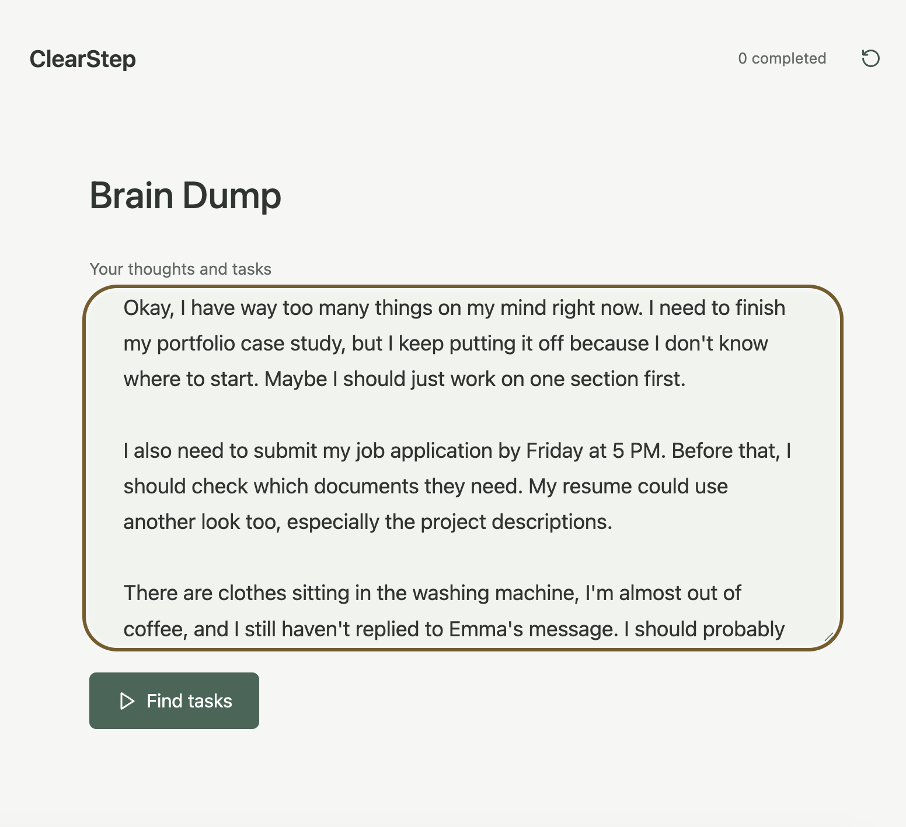
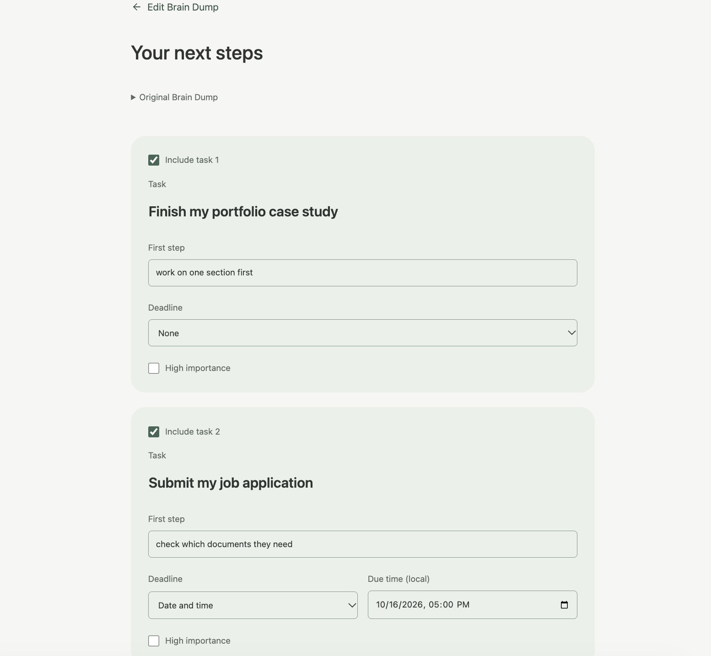
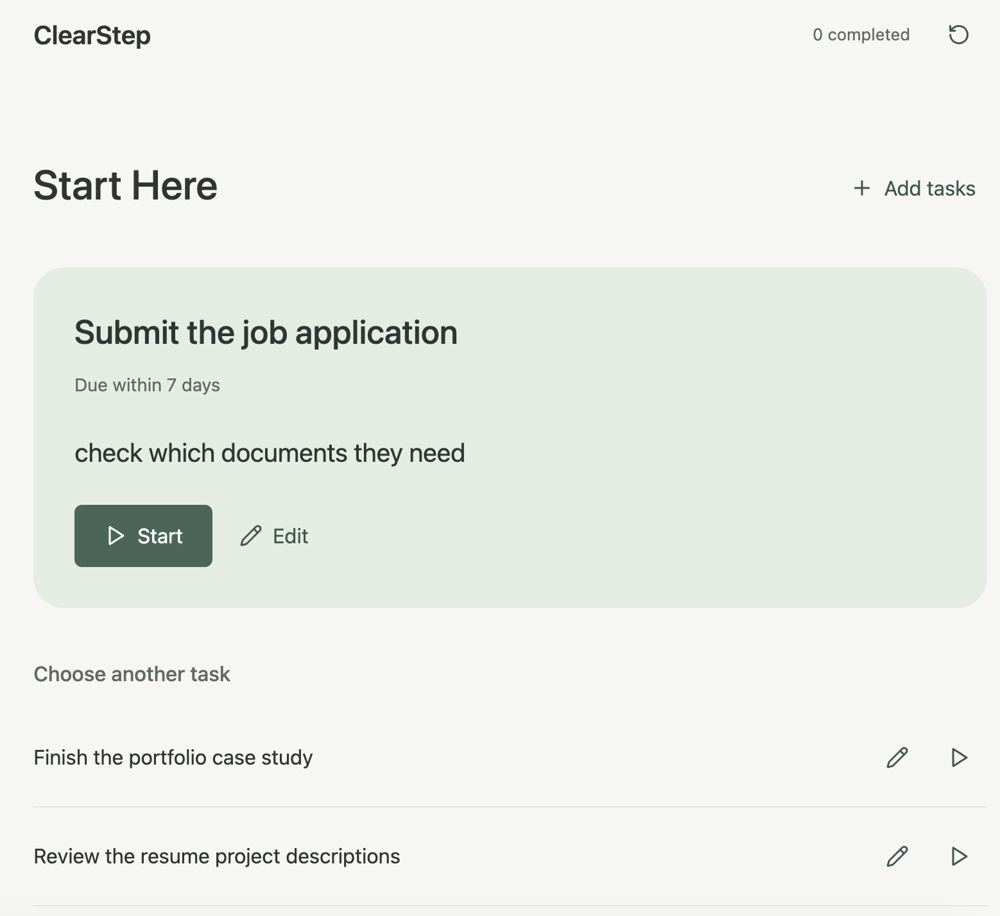
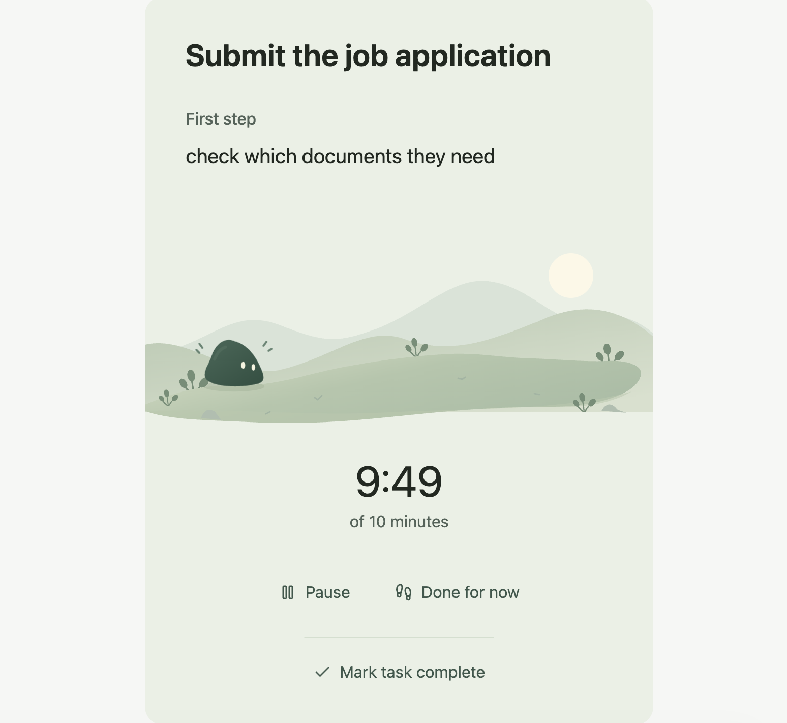

# ✨ ClearStep

**From mental clutter to a clear next step.**

ClearStep is a small AI-powered task app for those moments when you have too much on your mind and don't know where to start.

Instead of organizing everything yourself, just write it all down. ClearStep helps turn your scattered thoughts into actionable tasks, figure out what matters next, and ease into getting things done.

## How it works

1. **Brain Dump** — Get everything out of your head, messy thoughts and all.
2. **Review** — Let AI identify tasks, suggest first steps, and pick up on deadlines. You stay in control of what makes the list.
3. **Start Here** — A rule-based ranking system helps you decide what to tackle first.
4. **Focus** — Take one small step at a time, with an optional gentle timer and a little companion along the way.

| Brain Dump | Review |
| --- | --- |
|  |  |

| Start Here | Focus Mode |
| --- | --- |
|  |  |

## Under the hood

**Tech stack:** React · TypeScript · Vite · Python · FastAPI · OpenAI API · Pydantic · pytest

One of the main design decisions was to keep task understanding and prioritization separate.

The LLM handles the messy, human side of things: interpreting natural language and suggesting possible next steps. A deterministic Python engine handles ranking, so the same tasks and conditions lead to predictable results.

**LLMs understand. Software decides. Humans stay in control.**

Confirmed tasks are stored locally in the browser, while the backend stays stateless. Brain Dump text is sent to the OpenAI API for extraction.

## Testing & Evaluation

Because a valid JSON response doesn't always mean the AI understood correctly, I built a semantic evaluation suite to test things like task extraction, deadline interpretation, and first-step attribution.

- **117 offline backend tests** and **22 frontend tests** passing in the latest verified runs.
- **43/45** automated checks passed in the initial live LLM baseline.
- A targeted prompt update improved first-step attribution in selected cases; **10/12** subsequent targeted cases had no automated strict failures.

The two live runs used different prompt versions and test subsets. ClearStep still has known limitations, including occasional missed or incorrectly inferred tasks.

More details in the [Evaluation Guide](backend/evaluation/README.md).

## Run locally

You'll need Python 3.11+, Node.js, npm, and an OpenAI API key. These commands use a Bash-compatible shell.

**Backend** (from the repository root)

```bash
cd backend
python3 -m venv .venv
.venv/bin/python -m pip install -e '.[test]'
cp .env.example .env
```

Set `OPENAI_API_KEY` and `OPENAI_MODEL` in `backend/.env`. The model must support the Responses API with strict structured outputs. Then, still in `backend`, run:

```bash
set -a
source .env
set +a
.venv/bin/python -m uvicorn app.main:app --reload
```

**Frontend** (in a separate terminal, from the repository root)

```bash
cd frontend
npm ci
npm run dev
```

Open the local URL printed by Vite.

---

*Built around a simple idea: getting started shouldn't be the hardest part.* 🌱
